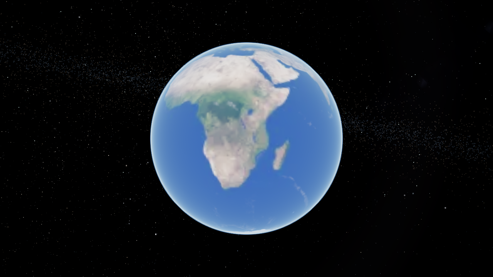

<div align="center">

# Planets Motion

### Explore a 1:1 real-time model of the Solar System

An interactive, browser-based Solar System explorer powered by NASA/JPL ephemeris data.
Travel from planetary orbits to the surface, then zoom out to the distant Solar System.

[](https://github.com/Monikakumari765/PLANETS-DETAIL)
[](LICENSE)
[](https://threejs.org)

**Repository:** [Monikakumari765/PLANETS-DETAIL](https://github.com/Monikakumari765/PLANETS-DETAIL)

**Maintainer:** Monika Kumari



</div>

## About

Planets Motion is a real-scale 3D exploration application that runs in a web browser. It combines sampled NASA/JPL states with analytical orbital models to show the positions and motion of planets, moons, comets, and other Solar System bodies. You can explore from space, descend through an atmosphere, and move around on supported planetary surfaces.

This project is an astronomy visualization and educational experience. It does **not** implement relativistic time-dilation telemetry, atmospheric spectroscopy, AI-generated habitability scores, or life-support probability calculations.

## Features

- **Real-scale exploration:** Solar System distances are represented at a 1:1 kilometre scale, from close-up surface views out to the Oort Cloud.
- **Ephemerides:** Uses sampled JPL states where available and analytical models as fallbacks. Sampled data is loaded progressively by target and year.
- **Explore in multiple ways:** Orbit a body, fly through space, or walk on supported surfaces; the interface also supports touch controls on mobile devices.
- **Rich Solar System:** Explore planets and moons, the asteroid and Kuiper belts, trans-Neptunian objects, comets, and Voyager spacecraft.
- **Detailed rendering:** Three.js, WebGL2, atmospheric effects, rings, procedural surface details, and optional terrain data.
- **Bilingual interface:** English and Chinese entry points.

## Preview

Browse the [project repository](https://github.com/Monikakumari765/PLANETS-DETAIL), or build and run the project locally.

## Run locally

Requirements: Node.js and npm.

```bash
git clone https://github.com/Monikakumari765/PLANETS-DETAIL.git
cd PLANETS-DETAIL
npm install
npm run dev
```

Vite prints a local URL, usually `http://localhost:5173`.

Useful commands:

```bash
npm test          # Run the offline Node.js test suite
npm run build     # Build the static site into dist/
npm run preview   # Preview a production build
npm run verify    # Compare ephemerides with NASA/JPL Horizons (requires internet)
```

## Large data assets

To keep this GitHub repository lightweight, large generated or downloaded asset directories are not included: `public/textures/`, `public/dem/`, and `public/data/ephemeris/`. The application can use procedural rendering and analytical ephemeris fallbacks where those assets are unavailable. The project includes scripts for regenerating data; for example, `npm run fetch-dem` and `npm run fetch-ephemeris` require an internet connection and create substantial local files.

## Tech stack

- JavaScript (native ES modules; no TypeScript)
- Three.js 0.165
- Vite 5
- WebGL2 and GLSL shaders
- Node.js built-in test runner

## Credits and license

The original MIT license and copyright notices are retained in [LICENSE](LICENSE). Third-party data and asset notices are documented in [THIRD_PARTY_NOTICES.md](THIRD_PARTY_NOTICES.md).

NASA/JPL ephemeris services and public planetary science data are acknowledged by their respective providers. See the notices and source links in the repository for details.
