# Solar Wanderer · Final Realism Assessment and Implementation Plan

> **Document type**: Comprehensive gap inventory + conclusions + actionable implementation roadmap
> **Baseline version**: Uncommitted candidate (v2.2.0) after workspace `85e7f53`
> **Date**: 2026-10-15
> **Goal**: *"Achieve perfect realism, model the entire Solar System 1:1, immerse users completely, and become indistinguishable from reality"*

---

## Reading Guide

This document is organized into three layers so readers can focus on what they need:

| What do you care about | Which chapters to read |
|---|---|
| One-sentence conclusion, what is left, what to do first | Summary → Chapter 1 → Chapter 4 → Chapter 8 |
| Concrete evidence for each gap | Chapter 3 + Appendix A |
| How to implement and how to calculate acceptance | Chapter 5, 6, 7 |

The code location quoted in the full text is always written as `file:line number`, and you can jump directly to check. All numbers can be reproduced using scripts in the repository (see appendix C).

---

## Summary (Conclusions First)

### One sentence conclusion

> **The current project is already engineering-reliable for "are the positions correct?" (planets ≤0.074°, matching JPL point by point), but it remains 2–3 orders of magnitude away from indistinguishability in "does the visible scene look right?" and "does it move correctly?" It also lacks an objective measurement system for determining resemblance. Without such a system, claims of having reached photorealism cannot be falsified or accepted as valid completion criteria.**

### Three Standards of “Indistinguishable” That Must Be Separated First

The user's goal actually combines three distinct standards. Mixing them makes the objective difficult to implement, so they must be separated first:

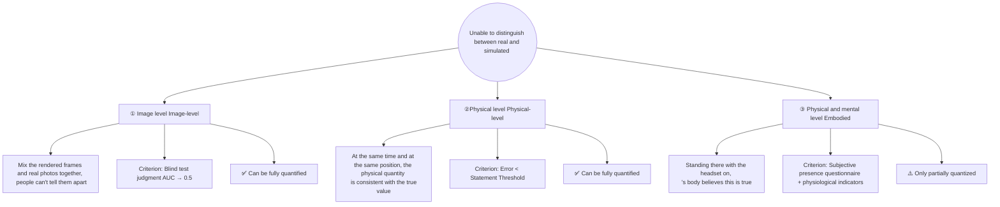

**These three items must be set up goals and accepted separately. ** The current project status is: ① The furthest difference and no measurement at all, ② Average and the best measurement, ③ Almost no movement.

### Overall score of current situation (according to three criteria)

| Standard | Completion (my estimate) | Basis |
|---|---|---|
| ① Image level "indistinguishable" | **About 35–45%** | Full scene pure Lambert lighting; zero material map except albedo; no multiple scattering, no volume clouds, no water surface reflection; no real terrain except Earth/Mars/Moon; no post-production (flooding/depth of field/lens) |
| ② Physical level "indistinguishable" | **About 50–60%** | Planet/moon analytical path** Actual measurement 2–3″ and 4×10⁻³°**, very good; but the satellite degrades to **1.2–6.0°**, the JPL interpolation window is only 16 months, and the model is changed silently outside the window; there is no N body/relativity/tide; the ΔT table is frozen and the 1800 error reaches 208 s; the player ship has no gravity at all |
| ③ "Indistinguishable" at the physical and mental level | **About 15–20%** | No 3D audio (all mono), no camera shake/landing impact, no movie mode, VR cannot move/no touch/no head-mounted display actual verification, no weather and season |

> **When you read through the code for the first time, you will find one thing: the precision numbers written in the project documents deviate in both directions from the actual code. **
> The planets and moon are ** more accurate than what is written in the document ** (the document says 0.074°, the actual VSOP87 truncation path is about 2–3″, which is 100 times better);
> The satellite ** is worse than what is written in the document ** (the document states "10 days ≤ 0.22°", and the actual measurement is Phobos deviated from 6.0° one year after the fitted epoch).
> This shows that "accuracy" is currently defined by test tolerances, not by model capabilities. This is the first thing stage 0 must address.

### The five most deadly bottlenecks (sorted by "input-output ratio")

| # | Bottleneck | Why Deadly | Evidence |
|---|---|---|---|
| **1** | **No realism measurement system** | It is impossible to judge whether any change is "more true" or "more false"; it is impossible to declare that the goal has been achieved; it is impossible to prevent regression | `tools/` has 130+ probe scripts, all of which are "no crash/no lag" assertions; `.audit-reports/comparison.html` only makes "candidate vs" Online "screenshot comparison", there is no quantitative comparison between the rendering results and real photos** |
| **2** | **Full scene pure Lambert lighting + zero material maps** | This is the largest single source of "fake". Hapke backscatter/opposition brightening of airless objects (Moon, Mercury, Jupiter, Pluto) is completely missing and the lunar surface looks like gypsum | `planetMaterial.js:303` = `albedo * max(ndl,0) * uSunI`; `grep envMap\|normalMap\|roughnessMap\|MeshPhysicalMaterial src/` Return **0 row** |
| **3** | **The real terrain is only the Earth/Mars/Moon, and it is hard-clamped in L4** | The code requests L8, but the data is only generated to L4 → **The lunar surface has only 2.67 km/px**, and the crater edge cannot be seen in the Apollo landing area | `terrain.js:876` request L8; `demTiles.js:46,55,64` `maxLevel: 4`; `demTiles.js:185` Silent pinch-off |
| **4** | **The player's spaceship has no gravity, just a "camera"** | The core experience of "1:1 Simulated Solar System" is flying; without flying, there is no way to verify any physical authenticity | `ship.js:445-524` `updateFly` **does not have any gm items**; no resistance, no fuel, no collision (only the nearest celestial body is a ball) |
| **5** | **The sky is 132 real stars + 11,900 random points + one JPEG** | Looking up from the earth's surface, the starry sky is the "indistinguishable" place where it is easiest to reveal | `starfield.js:21-154` (132 Hipparcos), `:197-218` (LCG) Random point cloud), `:165-184` (8K Galaxy map) |

### Key insight: The goal should not be "perfection", but "push the resolvable distance to the limit of the human eye"

"Indistinguishable everywhere" is not engineeringly provable (see Chapter 4). **The only executable form of the goal is to push the "resolvable distance D_res" below the limit of the human eye and prove it with a blind test. **

```
D_res (celestial body, direction) = surface sampling distance ÷ human eye angle resolution (1′)
→ When the observer is further away from the surface than D_res, it is physically impossible for the picture to reveal forgery
```

According to this ruler, the current situation is:

| Celestial body | Current map D_res | Current terrain D_res | Target |
|---|---:|---:|---:|
| Earth | 16,800 km | 33,600 km | After landing ≤ tens of meters |
| Moon | 4,600 km | 9,200 km | After landing ≤ tens of meters |
| Mars | 8,900 km | 17,900 km | After landing ≤ tens of meters |
| Jupiter | 377,000 km | — | ≤ 5,000 km |
| Uranus / Neptune | **269,000 / 261,000 km** | — | ≤ 20,000 km |

> How to read: Take Uranus as an example - you can see that the texture is blurred at a distance of 27 ten thousand kilometers (10 times the radius). To "not see flaws in the track", you need to increase the texture from 2048 to ~16K.

### Total workload and cycle

| Stage | Content | Full-Time Equivalency |
|---|---|---|
| Stage 0 | Reality Measurement and Discrimination Test Bench (**cannot be skipped**) | 3–4 Weeks |
| Stage 1 | Position and shape (ephemeris tightening + two-stage DEM + shape model) | 3–4 months |
| Stage 2 | Light and materials (physical radiation, BRDF, atmosphere, clouds, water, rings, sun, post-production) | 5–7 months |
| Phase 3 | Environment and time (weather, seasons, solar activity, precise eclipses, landmarks) | 3–4 months |
| Stage 4 | Presence (Flight Mechanics, Camera Language, Spatial Audio, VR) | 3–5 Months |
| Stage 5 | Closure (Performance, Accessibility, Content, Multilingual) | 2–3 Months |
| **Total** | | **Approximately 17–24 months full-time equivalent** |

At the current intermittent pace of the project (165 commits, approximately 4 months), a realistic expectation is **3–4 years**.

**But there are only two things that really need to be done right away**: the measurement platform of stage 0 (3–4 weeks, which determine whether each subsequent step is correct or not), and the **five "quick wins in one or two days"** listed in section 8.1. The two pieces together take less than a month, but they can simultaneously eliminate the most serious mistakes, make up for the most lacking capabilities, and make all subsequent investments measurable. See Chapter 8 for details.

---

# Chapter 1 Turn "indistinguishable" into a decidable engineering goal

## 1.1 Why the existing target cannot be accepted

"To the point where reality cannot be distinguished from simulation" is currently undecidable because it does not answer three questions:

1. **On which scale? ** "Indistinguishable" means completely different when looking at the earth from 10 million AU and looking at a stone from the earth.
2. **To whom? ** Human eyes? camera? Or a physical instrument?
3. **On which scene set? ** If there are only fixed screenshots of the 282 group, it can only prove the 282 group.

`RELEASE_READINESS.md:9` has honestly written this: *"It cannot be declared that 'photos and simulations are indistinguishable across the entire solar system, at all angles, on all hardware'"*. The first step in this plan is to turn it into something announceable.

## 1.2 Core Concept: Reality Frontier and Resolvable Distance

The solar system is divided into three domains based on the "distance between the observer and the surface". Each domain has different failure mechanisms:

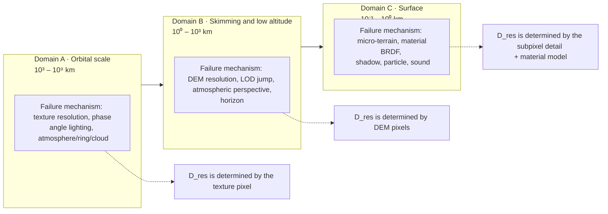

**D_res Definition** (core work indicators of this plan):

$$D_{res} = \frac{s}{\theta_{min}}, \qquad s = \frac{2\pi R}{N_{px}}$$

- `s` = surface sampling spacing (map pixels or DEM pixels)
- `θ_min` = Observer angular resolution threshold (human eye ≈ 1 angular minutes = 1/3438 rad)
- Meaning: **When the observer is closer than D_res, the picture starts to reveal that it is fake**

**The value of this indicator**: It turns a vague "like or not" into a number that has units, can be calculated, and can be entered into CI. Every time you add a layer of DEM and every time you change the texture, you can immediately calculate how much D_res has progressed.

## 1.3 Specific acceptance definitions of three domains

| Domain | Operational definition of "indistinguishable" | Measurement method |
|---|---|---|
| **A orbit** | At 20 standard viewpoints (celestial body × phase angle × distance), the renderings are mixed with real images of the same geometry, and human judgment is AUC ≤ 0.60 | Blind test platform + reference image library |
| **B Low Altitude** | At 12 landmarks (Apollo 11/17, Curiosity, Perseverance, Olympus Mons, Valles Marineris, Mount Everest...) 100 km / 10 km / 1 km At three heights, the error between the horizon profile and the **pixel-by-pixel elevation profile** of the real image < declaration threshold | Horizon contour extraction + elevation inversion |
| **C Surface** | Stationary for 10 seconds after landing, blind test with real photos of the same location (real photos of Apollo and Mars rover) AUC ≤ 0.60; and **without any timing artifacts** (LOD jump, map pop, light flicker) | Blind test + timing difference detection |

## 1.4 Discriminant Testing Protocol (the only legal "indistinguishable" proof)

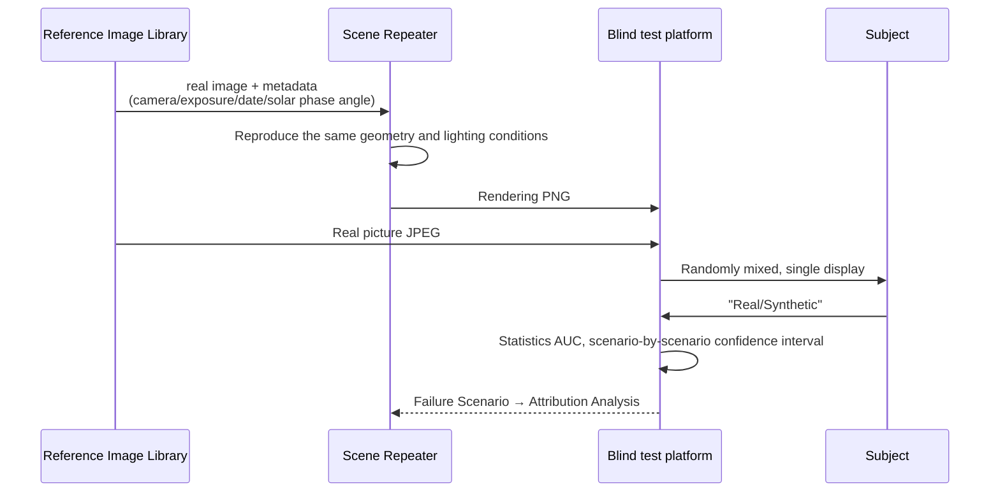

Mandatory requirements of the agreement (all are indispensable):

1. **The reference image must be a real image**, not an official rendering (part of the "rendering" of NASA is also CG, which will contaminate the results). Each record must have source, date, camera, and exposure.
2. **Geometry must be aligned**: same moment, same camera pose, same FOV. Otherwise, the test is "whether the angle is right" rather than "whether it looks like it or not."
3. **Fixed display conditions**: same monitor, same brightness, same viewing distance. If the brightness is different, the dark adaptation conclusion will be reversed.
4. **Sample size ≥ 30 subjects × ≥ 60 Plot pair**, reporting 95% confidence intervals for AUC.
5. **The composite image must not have a resolution advantage or disadvantage**: Both sides must be normalized to the same pixel size and the same noise level, otherwise the subject will be able to tell "which one is sharper".

> **Important reminder**: LPIPS / SSIM can only be used as **regression monitoring** and cannot be used as proof of "indistinguishability". They are learned perceptual distances that do not correlate well with human judgment when compared across domains (rendering vs real shots). **The only legal criterion is a blind test. **

---

# Chapter 2 Current Physical Examination (Reproducible Evidence Baseline)

## 2.1 Already done correctly (don’t redo it)

These are real assets. The plan only makes increments and does not touch the foundation:

| Achieved | Evidence |
|---|---|
| 1:1 real km scale, 0.5 m → 10 million AU | Floating origin (`floating.js:19-27`, double subtracted and then narrowed) + logarithmic depth (`rendererBootstrap.js:15`) |
| Planetary ephemeris matches JPL Horizons point by point | 520/520 independent comparisons (`RELEASE_READINESS.md:35`); JPL sampled ephemeris of 65 targets (`public/data/ephemeris/*.bin`, 14 MB, 2026-06 → 2027-10, SHA-256 verification) |
| HDR pipeline has been established | `main.js:86-90` HalfFloat + LinearSRGB; High file 4× MSAA, Low file FXAA |
| Atmospheric single scattering physics is correct | `atmosphere.js:121-162` Nishita formula, channel-by-channel Rayleigh/Mie coefficient + HG phase function; Mars blue sunset emerges naturally from `mieG:[0.60,0.65,0.72]` (`bodies.js:76-78`) |
| Real DEM pipeline (three-dimensional body) + seamless splicing | `demTiles.js` quadtree + LRU + global continuous pixel bilinear (`:294-338`, specially solves tile seams) |
| Ring-planet mutual shadow (analysis) | `planetMaterial.js:286-302` The sun's rays intersect with the ring plane; `rings.js:109-116` The planet's umbra is projected onto the ring |
| The surface of the Moon/Mars/Earth is ready for walking | Annular LOD 8 level (`terrain.js:584-630`) + shape-driven roughness + near-field ±400 m shadow (`builder.js:355-364`) |
| Progressive loading and failure recovery | L1 preview 0.36 MB → L2 1024px → L3 focus original image; weak network 5 s can enter (`RELEASE_READINESS.md:88`) |
| Hardware adaptive binning | `quality.js` GPU classification + P95 frame interval guard + dynamic resolution 1/0.88/0.76/0.65 |
| 136 passed all offline tests | `npm test` actual test 136/136 |

## 2.2 Measured asset resolution (this is the "false" physical upper limit)

**Map** (`public/textures/`, 23 pictures): All sources are Solar System Scope (CC-BY-4.0, secondary synthesis based on NASA/USGS data) and Steve Albers Science on a Sphere composite image (`tools/fetch-textures.mjs:1-4`).

| Celestial body | Original image pixel | Surface pixel | **Map D_res** | Determination |
|---|---:|---:|---:|---|
| Earth | 8192×4096 | 4.89 km | 16,800 km | There is no vulnerability only outside 2.6 times the radius of the earth |
| Moon | 8192×4096 | 1.33 km | 4,600 km | Fair |
| Mars | 8192×4096 | 2.60 km | 8,900 km | OK |
| Mercury | 8192×4096 | 1.87 km | 6,400 km | Fair |
| Venus | **2048×1024** | 18.6 km | 63,800 km | Poor |
| Jupiter | 4096×2048 | 109.7 km | 377,000 km | Poor (the Great Red Spot is a color patch on the map) |
| Saturn | 4096×2048 | 92.5 km | 318,000 km | Poor |
| Uranus | **2048×1024** | 78.4 km | 269,000 km | **Poor (10 times the radius is exposed)** |
| Neptune | **2048×1024** | 76.0 km | 261,000 km | **Poor** |
| Pluto | 4096×2048 | 1.82 km | 6,300 km | Fair |
| Europa | 4096×2048 | 2.39 km | 8,200 km | Fair |
| Callisto | **1800×900** | 5.44 km | 18,700 km | Poor |

> There are also **0 normal maps, 0 roughness maps, 0 specular maps, 0 displacement maps** - `grep -r "normalMap\|roughnessMap\|envMap\|MeshPhysicalMaterial" src/` returns to the 0 row.

**Terrain** (`public/dem/`, 123 MB, 3 objects × 342 tiles):

| Celestial objects | Data source | Current most detailed | Real data available | Gap |
|---|---|---|---:|---:|---|
| Moon | LOLA | L4 = 4096 px = **2.67 km/px** | 118 m/px (Global) | **23×** |
| Mars | MOLA | L4 = 4096 px = **5.20 km/px** | 463 m/px (global); HiRISE DTM 1 m/px (at 1200+) | **11×** |
| Earth | ETOPO1 | L4 = 4096 px = **9.77 km/px** | SRTM 30 m/px | **326×** |
| The remaining ~28 landable objects | **None** | Pure programmed noise | Mercury MESSENGER, Venus Magellan, Pluto New Horizons, Galileo/Cassini DTM | — |

**Fatal Details**: `terrain.js:876` **requests L8** while walking close to the ground, but `demTiles.js:185` silences `Math.min(level, maxLevel=4)`. In other words, there is a 16 resolution gap between the intent of the code and the reality of the data, and it is swallowed up silently.

**Other assets**: 5412 small celestial bodies (`public/data/smallbodies.json`, 478 KB); 21 satellites; TNO 28; 4 comets; 132 stars real + 11,900 random; construction product 224 MB.

## 2.3 "Fake" direct source list (actual measurement of rendering layer)

| Location | Current Situation | Consequences |
|---|---|---|
| `planetMaterial.js:303` | `albedo * max(ndl,0) * uSunI` | **Pure Lambert**. The airless object does not brighten at opposition to the sun, and the moon's surface looks like gypsum |
| `atmosphere.js:228-232` | Multiple scattering = a scalar compensation term `β*insc/(4π) * msFrac² * 0.35` | Wrong brightness at dusk, limbus, and under clouds |
| `atmosphere.js` (full text) | **No ozone layer** | The twilight blue band and the "Venus belt" cannot form correctly |
| `builder.js:405` | Earth cloud = `R*1.0035`'s single-layer textured spherical shell | No volume, no cloud shadow, no cloud top height, no edge highlight |
| `sun.js:129-131,167` | The corona is the **bulletin board facing the camera** of 12 R☉ and `occulted ? 1 : 0.000001` | **The corona is virtually invisible except during total solar eclipses** |
| `sun.js` (Full text) | No prominence, no color sphere, no transition zone, no solar wind; limb dimming is only one order `0.35+0.65μ` | The sun is one of the easiest celestial bodies to identify "fake" |
| `main.js:92` | **Explicitly disable bloom** | Lacks the most noticeable characteristic of overexposure to the human eye/camera |
| `main.js:86-103` | No depth of field, no motion blur, no lens flare/ghosting, no chromatic aberration, no grain, no TAA | The picture is "too clean", at first glance it is CG |
| `rings.js:34-50` | Ring = 256 segment × 2 **Zero thickness plane** at vertex | No self-shadowing, no spokes, no particles, no thickness |
| `terrain.js:411-432` | Water surface = three noise normals + fixed roughness 0.12 | No reflection, no refraction, no subsurface, no real wave spectrum |
| `belts.js:33-47` | Asteroid belt 14,000 point, Kuiper belt 9,000 point, Oort cloud 4,000 point, **position is constant** | schematic geometry, not simulation |
| `eclipses.js:133-181` | Eclipse = **Black Cone Grid** inserted in the scene (MultiplyBlending) | The surface of the hemisphere itself does not darken; no Bailey beads, colorless rings, and shadowless bands |
| `builder.js:425-428` | Distant celestial body = screen space glint sprite, size `dist*0.004` | Non-realistic reflected radiance |

---

# Chapter 3 General list of gaps

> Grading: **P0** = blocks the conclusion "indistinguishable"; **P1** = clearly perceptible; **P2** = polished.
> Each item is given: Phenomenon → Evidence → Impact → Solution number (corresponds to Chapter 5).

```mermaid
flowchart TB
ROOT["Reality Gap"]
ROOT --> A["A ephemeris and dynamics <br/> position correct"]
ROOT --> B["B geometry and terrain <br/> shape are correct"]
ROOT --> C["C light and material <br/> color brightness correct"]
ROOT --> D["D environment and time <br/> are right at this moment"]
ROOT --> E["E Perception and Presence <br/>Am I here or not"]
ROOT --> F["F Project and Assets <br/> Can't Run / Where Can the Materials Come from"]

A --> A1["A1 ΔT table frozen and history error"]
A --> A2["A2 no light travel time/light travel difference"]
A --> A3["A3 satellite only empirical fitting"]
A --> A4["A4 small celestial body 5412/million"]
A --> A5["A5 None N Body/Relativity/Tidal"]

B --> B1["B1 DEM is sandwiched in L4"]
B --> B2["B2 28 celestial bodies have no terrain"]
B --> B3["B3 small celestial bodies are all balls"]
B --> B4["B4 Saturn ring zero thickness plane"]

C --> C1["C1 pure Lambert without BRDF"]
C --> C2["C2 zero material map"]
C --> C3["C3 Atmosphere without multiple scattering/ozone"]
C --> C4["C4 volumeless cloud"]
C --> C5["C5 No reflection and refraction on the water surface"]
C --> C6["C6 Sun has no corona/prominence/halo"]
C --> C7["C7 without post-processing"]

D --> D1["D1 weather/season is programmed"]
D --> D2["D2 Eclipse is a cone, not a shadow"]
D --> D3["D3 no solar activity"]
D --> D4["D4 without zodiacal light/airglow"]

E --> E1["E1 player has no gravity/no resistance/no collision"]
E --> E2["E2 no camera language"]
E --> E3["E3 audio full mono"]
E --> E4["E4 VR cannot be moved"]

F --> F1["F1 no realism measure"]
F --> F2["F2 assets are secondary synthesis"]
F --> F3["F3 license ledger is incomplete"]
F --> F4["F4 only has two levels of image quality"]
```

## A. Ephemeris and Dynamics

> **Good news first**: The measured accuracy of the analytical paths of the planets and the moon** is much better than the project readme** - after VSOP87 is truncated to ~0.1″ threshold, 9 planets are the worst 8.8×10⁻⁴° (≈3″), moon Meeus The worst item 60+60 is 3.9×10⁻³°. Therefore, the following A problem is not "inaccurate ephemeris", but "unreliable boundaries and long-term behavior"**.

| Number | Phenomenon | Evidence (including actual measurement) | Impact | Level |
|---|---|---|---|---|
| **A1** | **ΔT leap stopwatch frozen at 2017, and 1972 applied the wrong 2005–2050 polynomial** | `time.js:22-34` ends at `2017-01-01`; `time.js:45-47` uses `62.92+0.32217t+0.005589t²` for `jd < 1972` (this formula only 2005–2050 are valid). **Actual measurement error: 1900 years +89 s, 1800 years +208 s, 1000 years AD +0.06 days, 3000 years BC +1.60 days** | The twilight line, local time, and moon position at all historical moments are all wrong (the earth’s rotation difference in 1800 years is 0.87°). **And the "time machine" is the core selling point of the project** | **P0** |
| **A2** | **Satellite analysis degrades to 1.2–6.0° within one year** (the document states ≤0.22°) | Actual measurement (relative to JPL, from fitted epoch JD 2461273.69): Io +134 d **1.73°** / +224 d **2.77°**; Phobos +405 d **6.01°**; Charon +405 d **2.64°**; while `tests/ephemeris.test.mjs:45-51` only samples a single point near the fitting epoch, so the test passes | **Any date outside the 2026-06-01…2027-10-01 window, or `.bin` When not loaded, the satellite system is visibly wrong** (the arrangement of Jupiter is a feature visible to Galileo) | **P0** |
| **A3** | **The moon entry in `moonsData` itself is wrong** | `nDegPerDay = 11.8138` of moon in `moonsData.generated.js` ⇒ period 30.47 days, true value 27.32 days (**+11.5%**); fitted lunar node retrogression rate −0.12°/year, true value −19.3°/year (**difference 160 times**). The **position** of the Moon does not follow this path (takes Meeus/ sampling), but the **orbital normal** follows (`builder.js:610`), and the normal determines the tidally locked attitude | The **orientation** of the Moon with all tidally locked satellites may be systematically skewed | **P0** |
| **A4** | No nutation (anywhere) | `grep nutation src/` → No match. IAU 2000A nutation amplitude ±17.2″ = 0.0048°, **larger than the planet’s own error 7 times** | The precession chain is incomplete; the polar axis/twilight line does not match during precise comparison | P1 |
| **A5** | No optical aberration (observer aberration), no solar ray deflection, no Shapiro delay | When light travels, only planets/satellites/TNO/ comets each do 2 fixed-point iterations (`builder.js:521-532`, `comets.js:141-156`); stars have no annual optical aberration | Star position difference 20″; Starlight deflection at the edge of the sun 1.75″ Not modeled | P1 |
| **A6** | **JPL sampling window is only 16 months, and the model is changed silently outside the window** | `public/data/ephemeris/manifest.json`: 2026-06-01 → 2027-10-01; `sampledEphemeris.js:33` returns out of bounds `null` and fall back to analytical model | HUD with warnings but satellites out the window ** Error 2–6°**. This is a time bomb of "one morning the application suddenly went bad" | **P0** |
| **A7** | The planets and the moon are actually spheres, and **oblateness is ignored** | `builder.js:394` only performs `scale.y` flattening on **non-landable** celestial bodies; the Earth (oblateness 0.00335 ≈ 21 km), Mars (0.00589), Mercury, Venus, Pluto and all satellites are rendered as true spheres | Difference in polar radius of the Earth 21 km; the horizon will be wrong when viewed from the polar regions | P1 |
| **A8** | There are only 21 satellites (actual ~890): Saturn 6/60+, Uranus 5/27, Neptune 1/16, Pluto 0/4, TNO satellites and **asteroid satellites are all 0** | `moonsData.generated.js` key enumeration | The Saturn system, Titan, Triton, Charon, etc. other than Titan are all missing | P1 |
| **A9** | There is no libration movement for any tidally locked object**; the classic fact that the moon's "59% surface is visible" cannot be presented | `rotation.js:102-115` 100% tidally locked attitude | The position and orientation of the moon's surface emergence are unreal | P1 |
| **A10** | Small celestial body: 5412 (3,199 main belt + 448 NEO + 1,765 periodic comet), sharing single epoch 2461200.5, pure two-body Kepler | `public/data/smallbodies.json`; `smallBodies.js:61-85`; `tools/fetch-small-bodies.mjs:16,30-32` | No perturbation, no non-gravitational terms, no shape/rotation/albedo; **Ceres/Vesta/Pallas/Juno does not exist as a "world"** | P1 |
| **A11** | The Asteroid Belt/Kuiper Belt/Oort Cloud are **static point clouds that never move** | `belts.js:7-47` (without `update`);
| **A12** | There are only 4 comets, and Halley's orbital root number is the close element of **1976 years**, nothing but the gravitational term | `cometOrbits.generated.js` (halley epoch JD 2439875.5 = 1976-04-22) | Halley’s return time will differ by several days; there are no interstellar objects (1I/2I is filtered out by `e<1`) | P2 |
| **A13** | 28 `nodeDot` / `periDot` of TNO **All 0** | `tnoOrbits.generated.js` object-by-object check | Intersection and perihelion frozen, no 3:2 resonance, no Kozai circulation, no scattering disk chaos | P2 |
| **A14** | No N body, no perturbation, no relativity, no tidal evolution, no J2 dynamics | Full warehouse `grep nbody\|perturbat\|J2\|tidal\|relativis\|integrat` → the only hit is `surfaceGravity = GM/r²` (`bodies.js:253-255`) | Mercury precession 42.98″/century, lunar retrogression 3.8 cm/, Io All tidal heating is missing | P2 |
| **A15** | Pluto is not in VSOP87, fall back to Standish, and the measured 7.8×10⁻³° (12 times worse than the other planets) | `vsop87.js:20,88-93,120-148` | Pluto is a popular target, but the accuracy is the worst | P2 |
| **A16** | Unimplemented JPL Table 2b (3000 BC–3000 AD entries), README's "±3000 years" lack planetary path support | `planets.js:14-51`; `README.md:127` | A1 Superposition, ancient/future dates are not credible | P2 |
| **A17** | Dead code and outdated comments: `moonGeocentricFast` (7 item rough sequence) is not referenced; VSOP87 comments say "0.001"/50–100 KB" is actually 0.1"/116 KB; Moon annotation says "0.2–0.3°" Actual measurement 4×10⁻³° | `moon.js:22-57`; `vsop87.js:3`; `moon.js:19` | Maintainers will be misled | P2 |

## B. Geometry and Terrain

| Number | Phenomenon | Evidence | Impact | Level |
|---|---|---|---|---|
| **B1** | **DEM data is only generated to L4, and the code request to L8 is silently clipped** | `terrain.js:876` vs `demTiles.js:46,55,64,185` | Lunar surface 2.67 km/px, the edge of the crater is not visible in the Apollo landing area. **This is the main reason for "the secret is revealed as soon as you reach the ground"** | **P0** |
| **B2** | Mercury, Venus, Pluto, Jupiter, Saturn, the moon, etc. **~28 landable celestial bodies have no terrain at all** | `terrain.js:134-160` pure fbm/ridged noise;
| **B3** | DEM The following details are synthetic noise with a fixed amplitude ≤1.6 m, which has nothing to do with the real terrain roughness | `terrain.js:122-131` (note "This is a detail, not an actual measurement DEM") | The microscopic texture of the moon surface is unreal | P1 |
| **B4** | The impact crater is a noise contour without a central peak/radiation pattern/sputtering blanket/degradation state | `terrain.js:66-72` | The most iconic landform feature of the moon is wrong | P1 |
| **B5** | The rock is a deformed icosahedron with hard-coded dispersion parameters (22 m grid / 330 m radius / 320 block) | `terrain.js:467-481, 367-406` | Close-up repetitive feeling | P2 |
| **B6** | Small celestial bodies are all spheres, without real shape models (67P, Bennu, Itokawa, etc. PDS all have them) | `terrain.js:614-621` uses a continuous height field | Unable to access the most recognizable small celestial body landforms | P1 |
| **B7** | Saturn's rings are zero-thickness planes; Uranus's rings are procedurally synthesized Gaussian belts; **Jupiter and Neptune's rings are completely absent** | `rings.js:34-50`; The most famous picture | **P0** |

## C. Light and Material (**the most profitable category**)

| Number | Phenomenon | Evidence | Impact | Level |
|---|---|---|---|---|
| **C1** | **Pure Lambert reflection in the whole scene** | `planetMaterial.js:303` | There is no opposition brightness for gasless celestial bodies (the brightness of the real moon surface can be increased by 40%+ during the full moon); There is no Oren-Nayar roughness effect for gassy celestial bodies | **P0** |
| **C2** | **Zero material map** (cannot line/roughness/specular/AO/ displacement) | `grep` Full warehouse 0 row | The surface looks like a "photographed ball" | **P0** |
| **C3** | Multiple scattering is scalar compensation; **No ozone layer** | `atmosphere.js:228-232`; `grep ozone` → 0 row | Twilight band, Venus band, limb brightness all wrong | **P0** |
| **C4** | The earth's clouds are single-layer textured spherical shells with no volume, no cloud shadow, and no height | `builder.js:405`; `planetMaterial.js:354-426` | The earth is "flat" when viewed from orbit | **P0** |
| **C5** | The water surface has no reflection/refraction/subsurface; the waves are three noise normals | `terrain.js:411-432` | The sea surface is "matte blue" | **P0** |
| **C6** | Sun: coronal bulletin board and usually invisible; no prominences/chromosphere/solar wind; limb dimming level 1 | `sun.js:129-131,167,80-81` | The sun is the most recognizable celestial body and also the most fake | **P0** |
| **C7** | **No post-processing**: no bloom, no depth of field, no motion blur, no lens flare, no chromatic aberration, no grain, no TAA | `main.js:86-103` (bloom is explicitly disabled, `main.js:92`) | Lack of "camera/human eye" physical characteristics, picture is "too clean" | **P0** |
| **C8** | The exposure is a pure function of the heliocentric distance and does not measure light | `main.js:1145` `clamp(pow(dSunAU,0.85),0.25,12)` | The exposure will not be automatically suppressed when the bright planet fills the field of view | P1 |
| **C9** | The gas giant strips/Great Red Spot/Saturn's hexagons are all programmed noise or textured pixels | `planetMaterial.js:172-216,257-262` | The position of Jupiter's Great Red Spot does not correspond to the system III longitude | P1 |
| **C10** | No planetary illumination (ground illumination earthshine), no ambient illumination, no sky ambient light | `planetMaterial.js:325` constant `+albedo*0.0035`; `main.js:81` AmbientLight 0.02 | The night side of the moon is completely dark | P1 |
| **C11** | Ice Giant/Panax has "Human Eye Dark Adaptation Compensation" `I^0.55` and `interiorBoost` display hack | `.audit-reports/engine.md:8.7`; `bodies.js:38` | Non-physical brightening, will fail when compared with real photos | P1 |
| **C12** | There are only 132 real stars + 11,900 random points; 4 quantized colors; no parallax (background)/no proper motion/none PSF | `starfield.js:21-154,197-218,210-215` | The starry sky is the main source of immersion on the surface, which is not currently true | **P0** |
| **C13** | No zodiacal light/solar/airglow | `belts.js:1-2` (explicitly not rendered) | One less layer of real structure in the night sky | P2 |
| **C14** | The comet tail is Sprite + cylinder + 220 points; 4 comets | `comets.js:78-108,96-99` | The comet is unreal | P2 |

## D. Environment and time

| Number | Phenomenon | Evidence | Impact | Level |
|---|---|---|---|---|
| **D1** | No dynamic weather: Earth clouds do not change with time/date; Martian dust storms are Ls driven noise; Jupiter's Great Red Spot drift is a visual approximation | `planetMaterial.js:227-238,148-172` | Footage of the same celestial body is decoupled from the real date | **P0** |
| **D2** | Edible black cone grid superposition, receiver surface illumination remains unchanged | `eclipses.js:133-181`; `.audit-reports/astro.md:7.4` | The sky does not darken during a total solar eclipse, and there are no Bailey beads/chromatic spheres | P1 |
| **D3** | Eclipse search only `alignment > 0.999` triples are collinear; only hardcoded 4 triples | `eclipses.js:37-89,212-246` | A large number of occultation events are missed | P1 |
| **D4** | No solar activity cycle (random sunspot positions, no butterfly diagram), no flares, no CME | `sun.js:76-77`; `.audit-reports/engine.md:8.4` | The surface of the sun has nothing to do with the real date | P1 |
| **D5** | No season vision: The polar cap of Mars is a programmed mixture, and the polar cap of the Earth is a white mixture driven by the latitude of the subsolar point | `planetMaterial.js:229-242,312-323` | The polar cap/sea ice does not match the real date | P1 |
| **D6** | No earth night airglow, no city light phase changes | `planetMaterial.js:326-331` (texture + 3.0 gain) | The earth is static at night | P2 |
| **D7** | Severe time domain aliasing at high speeds: 10 year/second** one frame = 61 day** | `hud.js:11` (upper limit 315576000×); `time.js:112`; `eclipses.js:223` | Mercury’s orbit, rotation phase, and eclipse events are skipped | P1 |

## E. Perception and Presence

| Number | Phenomenon | Evidence | Impact | Level |
|---|---|---|---|---|
| **E1** | **The player's spaceship has no gravity at all**: `updateFly` does not contain any gm items | `ship.js:445-524` (`gm` is only used in `updateWalk:578`) | Unable to fall freely, enter orbit, or stay; it will fly away from the earth when it stops | **P0** |
| **E2** | No atmospheric drag/lift/aerodynamic heating/reentry | `ship.js` full text; `inAtmosphere` for audio only | Reentry is the most impactful immersion scenario, currently completely unavailable | **P0** |
| **E3** | No mass/thrust/specific impulse/fuel/Δv; velocity is the first order lag or constant acceleration; upper limit 1000 c | `ship.js:389-390,479-485` | It is not aerospace dynamics, it is "camera translation" | **P0** |
| **E4** | Collision only "one ball of the nearest celestial body", regardless of terrain fluctuations | `ship.js:502-515`; `main.js:1000-1015` | Can 5 m altitude **through the mountains** | **P0** |
| **E5** | Walking without slope restrictions, no lateral collision, no acceleration/friction model; DEM update >5 **Silent vertical teleportation of players** when m | `ship.js:618,622,657-677` | Can walk up vertical cliffs and pass through rocks; the landing point will "jump" | P1 |
| **E6** | Underwater buoyancy is constant "half gravity upward", non-Archimedean | `ship.js:630,642` | Underwater behavior is not physical | P1 |
| **E7** | Player physics and simulation time are decoupled (using dtReal), unable to follow moving celestial bodies | `main.js:704,752`; `time.js:112` | 1× Unable to remain relatively stationary with any celestial body at speed | P1 |
| **E8** | **No camera language**: No vibration, no head shake, no landing shock, no FOV shock | `grep -rn "shake\|bob" src/` → 0 OK | All movements are "weightless" | **P0** |
| **E9** | **Audio Full Mono**: None PannerNode / AudioListener / HRTF / Doppler / Reverb Zone; only 4 layer synth sound; muted by default | `audio.js:283,312` (all connected to the same bus); `grep PannerNode\|PositionalAudio` → 0 row | Spatial hearing completely missing | **P0** |
| **E10** | No engine/thruster/reentry/UI sound; `setVolume`/`setVacuum` no caller within `src/` | `audio.js:87`; grep no caller | Volume and vacuum hiss out of reach on UI | P1 |
| **E11** | VR: No movement in fly/walk mode (`main.js:1378` exits early), no touch, no hand tracking, no comfort options, **post link skipped**, controller pickup is an empty pile | `webxr.js:317-324` (`_raycastBody` always returns null); `main.js:976-977` | VR Actually you can only zoom and select the target | **P0** |
| **E12** | No real phone verification: only Chrome touch/UA simulation; no AMD/Apple/ real phone/Safari/ head display | `RELEASE_READINESS.md:77,112` | Cannot claim "full hardware" | P1 |
| **E13** | **No "Movie/Pure Mode"**: No button or entry can hide HUD, directory, prompts, crosshair, label, compass at one time | Element-by-element switch only has `H/L/O/K/C` (`main.js:1046-1101`); **This is the item with the highest input-output ratio: half a day’s work** | **P0** |
| **E14** | **Navigated `action` field is never executed** | Checkpoint declares `action:'land'\|'lookAt'\|'zoomOut'` (`tours.js:55-59,271-307,199-203`), but `main.js:315-326` only passes `flyTo/select/getMode/setMode/hud`, **never reads `cp.action`** | In the three guides, the narrations of "landing on the lunar surface," "turning around to face the Earth," and "zooming out to the Oort cloud" do not match the scene** - the camera never lands, never turns around, and never zooms out | **P0** |
| **E15** | **Tour narration cut by CSS** | `#hud-tip` is `white-space:nowrap; max-width:90vw` and **no `overflow` rules** (`style.css:62-67`), and `body{overflow:hidden}` (`style.css:5`); Tour copy 150–300 The words (`tours.js:61-67`) are written into this element (`tours.js:527-533`) | The most important commentary in the product is **incomplete** and there is no subtitle layer | **P0** |
| **E16** | **Each tag has real-time distance numbers, cannot just display the name** | `labels.js:101` writes `formatDist()` into `.ld` every frame; no brightness/magnitude grading, no "only the most recent N" budget, up to 199 DOM tags | The sky becomes a measurement dashboard, not the sky | P1 |
| **E17** | No novice guide; the entire warehouse `localStorage` is only used for bookmarks | `grep onboard\|tutorial\|firstRun src/` → 0 line | There is no entry for the three navigations, teacher tools, and bookmarks | P1 |
| **E18** | **Basically missing accessibility** | `user-scalable=no` (`index.html:5`); CSS **without any `:focus-visible`**; tags/search results are `<div>` without `tabindex`/`role`; without `aria-live`; `prefers-reduced-motion` Only works on startup page animation (`style.css:872-878`); no color blind mode | WCAG 1.4.4 and other hard failures | P1 |
| **E19** | **PWA manifest exists but not Service Worker** | `public/manifest.json` declares `display:fullscreen`; `grep serviceWorker\|workbox src/` → 0 row | 86 MB map + 123 MB DEM + 14 MB ephemeris **cannot be pre-cached**; the teacher tool's promise of "copying to the U disk and opening it offline" does not hold true | P1 |
| **E20** | Education/tool module "implemented, no entrance": teacher toolkit, bookmark management, TTS's speech rate/volume/tone, vacuum sound effect switch | `teacher.js` is only instantiated and linked to `window.__game` (`main.js:329-335`); `bookmarks.js:115-151` does not have UI; `tts.js:135-153` `setRate/setVolume/setPitch` has no call; `setVacuum` has no call UI | A large number of completed functions are asleep | P2 |
| **E21** | Ceres/Vesta and other 5412 real small celestial bodies, Apollo/Mars rover landmarks **cannot be searched, do not display tags, cannot go to** | `main.js:400-450`'s `buildRegistry` never produces `kind:'poi'`, `search.js:158`'s `KIND_LABEL.poi` is dead code | The most story-telling places cannot be visited | P1 |
| **E22** | Main loop rebuilds 3 times per frame HUD `innerHTML` + 199 tags once each `clone().project()` and DOM queries | `hud.js:75,103,133`; `labels.js:84,101` | Every frame throws 5–10 in vain ms, grab the rendering budget directly | P1 |

## F. Engineering and Assets

| Number | Phenomenon | Evidence | Impact | Level |
|---|---|---|---|---|
| **F1** | **No realism measurement system** | `tools/` 130+ scripts are all function/performance assertions; no reference image library, no perceptual indicators, no blind testing | **Unable to accept "indistinguishable"** | **P0** |
| **F2** | All textures are secondary synthesis (Solar System Scope / Steve Albers), not USGS/LROC/Cassini original scientific mosaic | `tools/fetch-textures.mjs:1-4` | Resolution and color are not the upper limit | P1 |
| **F2b** | **Only 18 among the 31 objects have stickers**: Phobos/2, Mimas/2/3/4/5/8, Titan/2/3/4/5 are all programmed | `public/textures/` Actual number of files vs `bodies.js` list of celestial objects | These satellites are "fake balls" when viewed in orbit | **P0** |
| **F2c** | 28 comets TNO and 4 comets **without any textures** | Same as above | All programmed noise | P1 |
| **F2d** | The downloaded `newhorizons.bin` and `SPACECRAFT_TIMELINES` are **dead resources/dead imports**, only the traveler 1/2 | `main.js:46,181-195`;
| **F3** | The pixel-by-pixel observation source and uncertainty ledger has not been established | `RELEASE_READINESS.md:149` | Unable to mark "Where is the guess" | P1 |
| **F4** | Only two gears High / Low; no bandwidth awareness; no dynamic resolution in VR | `quality.js:3-14,29-30,75-78` | No suitable gear for mid-range devices | P1 |
| **F5** | **Zero testing** under `src/engine/` | `tests/` only has 5 ephemeris/physics test files | No regression protection for engine changes | P1 |
| **F6** | Rendering accuracy: fp32 at the remote entity position, 1 at AU ULP ≈ 16 km, 10⁴ AU at ≈ 10⁶ km | `floating.js:19-27` | Distant small celestial bodies will jump | P1 |
| **F7** | Build product 224 MB, including DEM 123 MB | Actual measurement | Deployment and first screen pressure | P2 |

---

# Chapter 4 Fundamental Limitations (boundaries that must be recognized first)

This chapter is the honest part. **The following four limitations cannot be eliminated through engineering means**, and the design of the solution must circumvent them rather than pretending that they do not exist.

## 4.1 The boundary of observation data: the unknown area is always unknown

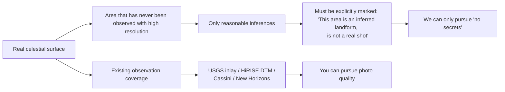

**Specific numbers**: Mars global MOLA 463 m/px has coverage, but HiRISE 1 m/px only has **1,200+ locations** from DTM to 2026, covering less than 2% of the Mars surface. Lunar LOLA Global 118 m/px Full coverage, but **5 m/px only covers limited areas**. Earth SRTM 30 m covers 60°N–56°S, and the polar regions and seabed depend on GEBCO (approximately 450 m).

**Conclusion**: Reality goals must be **layered**——

- **Area with real observations** → Pursuing "indistinguishability from real photos"
- **Inference Area** → Pursue "no exposure of inference traces" (statistically reasonable roughness, reasonable pit density)
- And **must switch to display "evidence level"** on UI, which is scientific research-level honesty and educational value.

## 4.2 Browser computing power boundary: real-time global illumination is impossible

| Desired effect | Physically correct approach | Real-time feasibility | Necessary approximations |
|---|---|---|---|
| Atmospheric multiple scattering | Full path tracking | ✗ | Precomputed LUT (Bruneton formula) |
| Volume Cloud | High Step Count raymarch + Multiple Scattering | ✗ | Low Step Count + Precomputed Lighting + Temporal Reuse |
| Planetary mutual illumination GI | Global illumination | ✗ | Analytical approximation + spherical harmonic ambient light |
| Real water surface | Ray tracing reflection/refraction | ✗ | SSR + screen space refraction + pre-filtered environment map |
| Ring particles | 10⁹ particles | ✗ | Texture optical depth + sparse particle superposition |
| Gasless celestial body BRDF | Hapke full integration | △ | Pre-integration BRDF LUT (same method as PBR) |

**Conclusion**: All "physical correctness" must be implemented in the form of **precalculation + approximation**, and **each approximation must have an upper bound on the error from the true value**. That's why stage 0 (metric) must be done first - it determines whether each approximation is "good enough" or not.

## 4.3 Decidability boundary: "Indistinguishable everywhere" is not provable

It is impossible to enumerate: about 30 celestial bodies × continuous viewpoints × continuous time × continuous lighting conditions. **So the correct target form is:**

$$\text{Target} = \big(\text{Scenario Set} \mathcal{S},\ \text{Discrimination Threshold} \tau\big) \quad\text{Making}\quad \text{AUC}(\mathcal{S}) \le \tau$$

**"Indistinguishable" = Passes a blind test on a well-stated, reproducible, and scalable set of scenarios. ** The larger the set of scenes, the more convincing it is, but it is never "all". This must be made clear in documentation and external communications.

## 4.4 Conclusion: The goal should be rewritten like this

> **Original Goal**: Perfectly realistic, 1:1 simulates the entire solar system to the point where reality and simulation are indistinguishable.
>
> **Executable goals (recommended for external use)**:
>
> **G1｜Image level**: On the declared scene set `S` (the first batch of 60 viewpoints, expanded quarterly), **Human blind test AUC ≤ 0.60**.
> **G2｜Physical level**: Position error ≤ 1×10⁻⁴° (vs JPL); historical moment ΔT error ≤ 0.5 s; surface DEM in the observation area ≤ 5 m/px.
> **G3｜Experience level**: Complete the 30 minute non-stop mission on a real machine (surface walking → takeoff → orbit → interstellar transfer → reentry → landing) without any timing artifacts, subjective presence scale ≥ 4.0/5.
> **Supplement**: All inferred regions are marked with evidence levels on UI; all approximations are given upper error bounds in the document.

---

# Chapter 5 Implementation Plan

## 5.0 Overall architecture

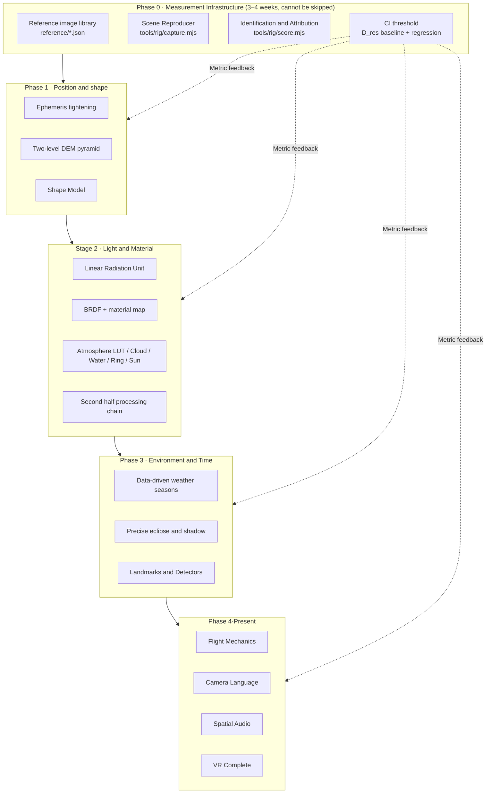

**Dependencies are hard**: There is no stage 0, and each step of stages 1–4 cannot answer "whether it is truer". This is also the biggest difference between this article and the `docs/sdlc/photorealism-roadmap.md` already in the warehouse - that roadmap lists the modifications of 40, but none of them provides "how to prove that it is more authentic after the modification is completed."

---

## Phase 0 · Reality Measurement and Discrimination Test Bench (3–4 Weeks)

### Target

Turn "like or not" into a number that can be run in CI.

### Deliverables

**0.1 Reference Image Library** `reference/scenes/*.json`

One record per scene, fields:

```jsonc
{
  "id": "moon-apollo11-orbital-100km",
  "body": "moon",
  "camera": { "lat": 0.674, "lon": 23.473, "altKm": 100, "fovDeg": 58, "azimuth": 180 },
"epochJD": 2460000.5, // The shooting time of the reproduced image (if any)
  "illumination": { "sunPhaseDeg": 12.4, "subsolarLat": 1.2, "subsolarLon": 23.1 },
  "reference": {
    "file": "reference/images/apollo11_lroc_100km.png",
    "source": "NASA/LRO LROC NAC", "date": "2011-09-06",
    "cameraModel": "...", "exposure": "...", "credit": "NASA/GSFC/Arizona State University"
  }
}
```

The first batch of 60 scenarios (covering three domains):

| Domain | Scenario | Reference Sources |
|---|---|---|
| A orbit | Earth full phase/half moon phase/new moon phase, Jupiter, Saturn + rings, Uranus, Neptune, Mars, Venus, Mercury, Pluto | NASA/JPL Photojournal, Cassini, New Horizons, Juno, Messenger |
| B low altitude | Apollo 11/17 landing area, Curiosity/Perseverance landing area, Mount Olympus, Valle Marineris, Mount Everest, South Pole of the Moon | LROC NAC, HiRISE, CTX, ISS Photography |
| C surface | Apollo 11/17 lunar surface, Curiosity/Perseverance panorama, Mars sunset, lunar surface emergence | NASA real shots (including official panoramic stitching) |

**0.2 scene reproducer** `tools/rig/capture.mjs`

Reuse the existing Puppeteer infrastructure (`tools/release-catalog.mjs` already has automatic flight to 70 destinations) and extend it to:

- Press JSON to accurately set `lat/lon/dist/FOV/azimuth/epochJD`
- Force a fixed exposure (disable automatic exposure) to align with the exposure conditions of the reference image
- Output PNG + `.json` in the same directory (record actual camera parameters, `D_res`, rendering overhead)
- Stability: Continuously shoot 3 frames with the same parameters. If the pixel-by-pixel difference is > the threshold, it will be judged as "timing unstable" and fail.

**0.3 Identification and Attribution** `tools/rig/score.mjs`

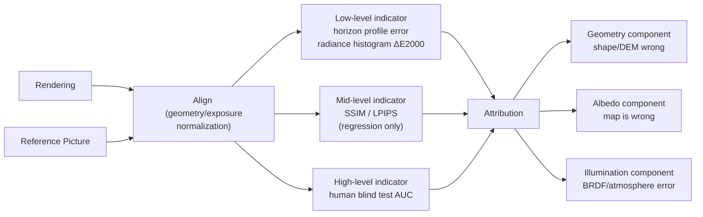

**Attribution method** (this is the most technical part of this stage): Decompose the rendering result `I_render` and the reference `I_ref` into three orthogonal components - geometry (horizon/outline position difference), albedo (chromaticity ratio after delighting), illumination (radiance ratio under the same albedo). In this way, every difference can automatically point to the specific gap number in Chapter 3, rather than "it doesn't look like it".

**0.4 CI Threshold** `.github/workflows/realism.yml`

- Records for each scene: `D_res`, horizon error, ΔE2000, SSIM, LPIPS
- **Regression failure** relative to the baseline (any indicator regresses > 5%) blocks merging
- Rerun a complete blind test every quarter and produce AUC report

### Acceptance

- All 60 scenes can be reproduced with one click, and the output can be reproduced (pixel-by-pixel difference of 3 consecutive runs with the same parameters < 0.5%)
- `D_res` numbers are given for each scene, summarized into a "Reality Frontier" summary table
- Complete at least one round of 30 human blind testing and get the baseline AUC

### Workload

3–4 weeks (reference image collection and copyright checking account for about half).

---

## Stage 1 · Position and shape ("where, what shape")

### 1.1 ephemeris tightening (corresponds to A1–A17)

| Task | Practice | Acceptance |
|---|---|---|
| **Fix ΔT** (A1, highest priority, 1–2 days) | Use complete Espenak & Meeus piecewise polynomials (−500 → 2005) + IERS actual measurement table (1973 → today) + 2026 Post-extrapolation curve; when `npm run verify`, pull the latest leap second from IERS | 1800/1900/1950/2000/2026 The error in each year is ≤ 0.5 s |
| **Modify the moon entry** (A3, half a day) | Correct the `nDegPerDay` (30.47 → 27.32 days) of moon in `moonsData` and the node regression rate (difference 160 times); add assertions to prevent further regression | The lunar orbit normal is consistent with the theoretical value |
| **Satellite Accuracy and Window** (A2, A6) | Galileo Samsung Laplace resonance phase locking; each satellite changes **multi-epoch (≥6) fitting** and adds high-order long-term rate; expands the JPL sampling window from 16 months to 10 years and refreshes in quarterly increments; when out of bounds HUD A clear reminder that "the current model is an approximate model" | Within the window ≤ 0.01°; outside the window ±1 years ≤ 0.1° |
| Nutation and precession (A4) | IAU 2006/2000A complete rotation chain replaces a single ecliptic precession term | Comparison with SOFA ≤ 1 mas |
| Light travel time and light aberration (A5) | When rendering and positioning, press `t − d/c` to iterate 2 times (existing); stars add annual light aberration; optionally add solar ray deflection | Compare with Horizons observer mode ≤ 1″ |
| Oblateness (A7) | Earth/Mars/Mercury/Venus/Pluto and satellites render real oblateness, and simultaneously correct terrain, collision, and picking | Earth polar radius 6356.75 km |
| Satellite expansion (A8, A9) | 21 → 60+ (medium-sized satellites of the Saturn system, all celestial satellites, main members of Triton, and Charon); add balance motion | List + visual verification |
| Small celestial bodies (A10, A11) | The main belt is sorted by diameter and takes the first 10,000 5 + the full amount of NEA + the full amount of comets; **statistical point clouds are changed to real orbit instances, moving with time**; Ceres/Vesta/Pallas/Juno is upgraded to the real world (shape model + rotation) | spot check 50 vs Horizons ≤ 0.01° |
| TNO and comets (A12, A13) | Supplement `nodeDot/periDot`; Supplement non-gravitational parameters of comet A1/A2/A3; Include interstellar objects | ±10 years ≤ 0.05° |
| Relativity/Tides (A14, optional) | Mercury perihelion precession additional rate; Phobos/ long-term lunar tide rate (teaching display switch only) | Values ​​are consistent with theoretical values ​​|

### 1.2 two-level DEM pyramid (corresponding to B1, B2 - **maximum single income**)

**Issue**: Globally uniform quadtrees are not scalable. Currently L4 = 32 MB/ celestial body; if pushed to L8 (lunar LOLA level) according to the same plan, **8 GB/ celestial body** is required.

**Scheme: Global Skeleton + Regional Patches**

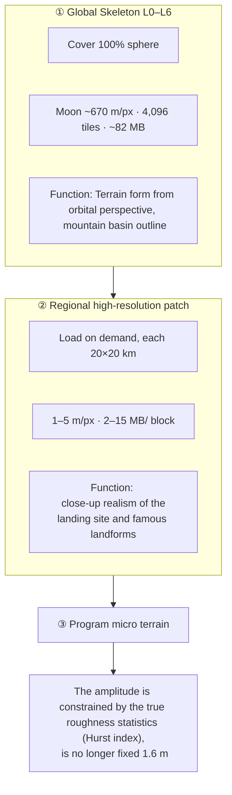

**Capacity estimate (actual measured numbers)**:

| Project | Moon | Mars | Earth |
|---|---:|---:|---:|
| Current status (L4) | 41 MB | 41 MB | 41 MB |
| Global Skeleton L6 (670 m/px) | ~82 MB | ~82 MB | ~82 MB |
| Single 20 km landing zone @ 5 m/px | 7.6 MB | 7.6 MB | 7.6 MB |
| Single 10 km fine zone @ 1 m/px | 47 MB | 47 MB | 47 MB |

**Recommended ratio**: Global skeleton L6 (3 celestial body ≈ 250 MB) + 20 landing zones × average 5 MB ≈ 100 MB. **The total is about 350 MB**, which is 3 times that of the current 123 MB, but in exchange for the global terrain resolution being increased by 4 times and the landing area being increased by 50–500 times.

**Data source table** (by celestial body):

| Celestial Objects | Global Skeleton Sources | Resolution | Regional High-Resolution Sources |
|---|---|---|---|
| Moon | LOLA (LRO) | 118 m/px | LROC NAC DTM, special products for Apollo landing area |
| Mars | MOLA | 463 m/px | HiRISE DTM (1,200+, 1 m/px), CTX DTM |
| Earth | SRTM / ASTER GDEM | 30 m/px | Regions LiDAR / Photogrammetry; for seabed GEBCO 450 m |
| Mercury | MESSENGER MLA + MDIS DTM | ~500 m/px onwards | USGS partial DTM |
| Venus | Magellan altimeter | ~1–5 km/px | (no better data, accepted) |
| Pluto | New Horizons LORRI stereoscopic | ~1 km/px partial | partial stereoscopic DTM |
| Europa/Ganymede/Callisto/Io | Galileo + Juno stereo | partial | USGS available DTM |
| Titan | Cassini RADAR SAR Altimeter | Local | (Globally limited by atmosphere, accepted) |
| Enceladus/Mimas/… | Cassini ISS stereo | partial | few |

> **Honest explanation**: Venus only has the Magellan kilometer-level altimeter on the planet; Titan is covered by fog. It is **impossible** for these celestial bodies to reach the lunar surface level of realism and must be labeled truthfully. This is exactly the layering principle behind the 4.1 section.

### 1.3 shape model (B6)

**DSK / that accesses PDS Small Bodies Node Triangle shape model**: 67P (Rosetta), Bennu (OSIRIS-REx), Itokawa (Hyabusa), Eros (NEAR), Vesta/Ceres (Dawn), Phobos/Deimos, etc. Rendering changed from "Height Field Sphere" to **Real Triangle Mesh + Collision Mesh**.

### Acceptance

- Moon/Mars/Earth global terrain D_res ≤ 1,000 km (no flaws in orbital scale)
- 20 landing zones D_res ≤ 50 km (i.e. 5 m/px cannot be seen in 50 km)
- Use realistic shape models for at least 8 small objects

### Workload

3–4 months (the data pipeline accounts for the majority).

---

## Stage 2 · Light and material (**Visual qualitative change stage**)

### 2.1 linear radiation unit (corresponds to C8, C11)

**Status quo is "looks right" rather than "calculates right"**: Solar intensity `uSunI = 13 * multiplier` (`builder.js:638`), exposure `pow(dSunAU, 0.85)`, gas giant `interiorBoost` to `1+depth²*24` (`main.js:1176`), outer solar system `I^0.55` compensation.

**Modification**:

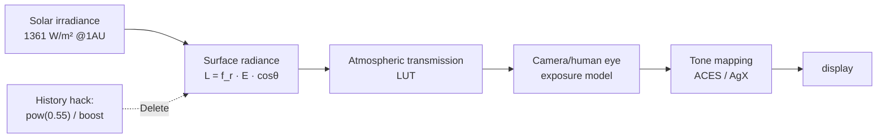

- All materials are changed to physical units (W/m²/sr), and the render target remains HalfFloat
- Exposure changed to **frame based metering** (log mean brightness + histogram) instead of heliocentric distance
- Delete all `pow(0.55)` / `interiorBoost` / `uGrade` classes hack (use LUT in the calibration process instead)
- The human eye's dark adaptation is modeled in stages using real time constants (minutes for dark adaptation, seconds for light adaptation)

**Risk**: This step will change the sense of the entire scene and must rely on the return to baseline of stage 0.

### 2.2 BRDF and material maps (corresponding to C1, C2 - **the largest single income**)

| Object type | Target BRDF | Reason |
|---|---|---|
| Airless celestial bodies (Moon, Mercury, Callisto, Pluto...) | **Hapke** (including opposition brightening, backscattering) | Full Moon brightening 40%+, which is the most significant feature of all lunar photos |
| Objects with regolith (Mars, bare Earth) | Hapke or Oren-Nayar | Rough diffuse reflection |
| Giant gas cloud top | Lambert + anisotropic cloud belt | Cloud top close to Lambert |
| Ice/water surface | GGX + Fresnel + subsurface approximation | Specular reflection |
| Ring | Particle phase function integral (precomputed LUT) | Backlight/front light appearance is completely different |

**Material mapping pipeline** (currently 0 pictures):

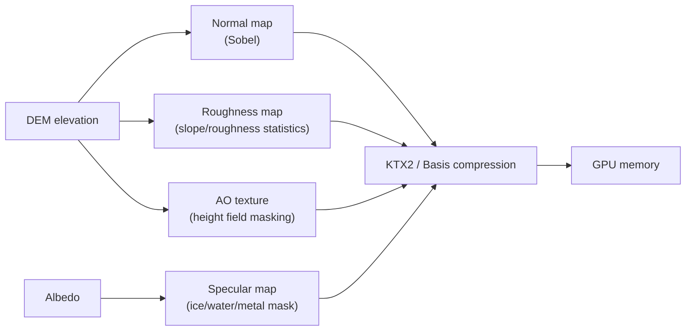

**Derivate instead of buy**: Normals, roughness, AO can all be scripted from existing DEM at a much lower cost than finding ready-made maps.

### 2.3 Atmosphere (C3), Cloud (C4), Water (C5), Ring (B7), Sun (C6)

| Subsystem | Solution | Key parameters |
|---|---|---|
| **Atmospheric Multiple Scattering** | Precalculated LUT: transmittance LUT (2D) + multiple scattering LUT (3D/4D, Bruneton formula). Generated offline for each planet, sampled three times during runtime | Earth elevation 8 km, atmosphere top 100 km (currently only 60 km, `bodies.js:49`) |
| **Ozone layer** | Add O₃ absorption cross-section (Chapman profile, peak 25 km) to the transmittance LUT | The key to the twilight blue band and Venus belt |
| **Volume Cloud** | Low level: limited number of steps raymarch (16–24 steps) + 3D noise + precomputed lighting; high level: cirrus map. Cloud projection onto the earth's surface | Need to cooperate with time domain reuse to run |
| **Water surface** | FFT or Gerstner wave spectrum + SSR reflection + screen space refraction + subsurface scattering + foam | Currently there are only three noise normals |
| **Ring system** | Optical depth map (real Cassini data) + particle phase function LUT + ring-ring self-shadowing + sparse particle superposition; supplementary Jupiter ring/Neptune ring | Saturn ring is currently a zero-thickness plane |
| **Sun** | Fifth-order polynomial limb dimming (real photosphere); change the corona's 3D structure (or at least make it visible at the apparent angle during non-solar eclipses); add prominences and chromosphere red edges; add solar wind particles | The current corona is invisible except for total solar eclipses |

### 2.4 Second half processing chain (C7)

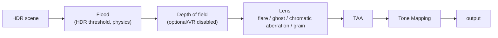

**Note the separation of "two sets of optics"**: The human eye and the camera are different imaging systems.

- **Human Eye Mode** (default): no lens flare, no ghosting, with glare diffusion (approximated by PSF convolution), with dark adaptation
- **Camera Mode** (switchable): lens flare, ghosting, chromatic aberration, grain, aperture diffraction starburst

Currently `main.js:92` explicitly disables bloom, citing "non-physical" reasons. **This decision is right but not optimal** - the correct approach is not to disable it, but to change it to "HDR threshold-driven physical bloom", which simulates light scattering in the eye/lens and is itself physical.

### Acceptance

- 60 scenarios for stage 0, AUC dropped from baseline to ≤ 0.70 (when stage 2 is completed)
- In the scene-by-scene attribution report, the "illumination component" error dropped significantly (this is the core of this stage KPI)
- Panoramic performance does not fall back (High level is still 60 FPS)

### Workload

5–7 months, which can be divided into 4 sub-batches that can be independently released:

| Batch | Content | Revenue |
|---|---|---|
| 2-A | Linear radiation + physical bloom + material mapping pipeline | Visible immediately |
| 2-B | Hapke BRDF (gasless objects first) + atmosphere LUT + ozone | Moon surface/Earth twilight qualitative change |
| 2-C | Volume cloud + water surface + ring system | Earth/Saturn qualitative change |
| 2-D | Sun + rear half processing chain | Closing |

---

## Stage 3 · Environment and time ("Is this moment right?")

| Task | Practice | Data Source |
|---|---|---|
| Earth cloud (D1) | Double-layer structure + load cloud image according to **real date** (historical phase can be archived with MODIS/GOES), or program cloud + real climate mean constraint | NASA GIBS / MODIS |
| Mars dust storm (D1) | Driven by real Ls + dust storm index (TES/MCS optical thickness record) | NASA PDS |
| Polar cap and sea ice (D5) | Mars CO₂ polar cap retreat curve according to the real Ls; Earth sea ice uses NSIDC monthly average | NSIDC / MOLA |
| Solar activity (D4) | Sunspots are distributed according to the real solar cycle phase and butterfly diagram; the corona shape changes with the activity cycle | SDO / SILSO sunspot number |
| Precise eclipses (D2, D3) | Bessel root method replaces alignment threshold; shadows are changed to do "occlusion list" light attenuation (real dimming + reddening) in the receiver shader; all planet-satellite combinations are covered | Five Millennium Canon of Solar Eclipses |
| Zodiacal light/airglow (C13) | Zodiacal light wedge brightness according to the DIRBE model; thin shell of airglow on the night side of the Earth | COBE/DIRBE |
| Landmarks and detectors (to be added) | Apollo/Apollo lunar ruins, Curiosity/Perseverance tracks, Voyager/New Horizons/Juno/Cassini real 3D models + real tracks | NASA PDS / JPL Horizons |

### Workload

3–4 months.

---

## Stage 4 · Presence ("Am I here or not")

### 4.1 Flight Mechanics (E1–E4, E7)—— **This is the question of "1:1 Simulation"**

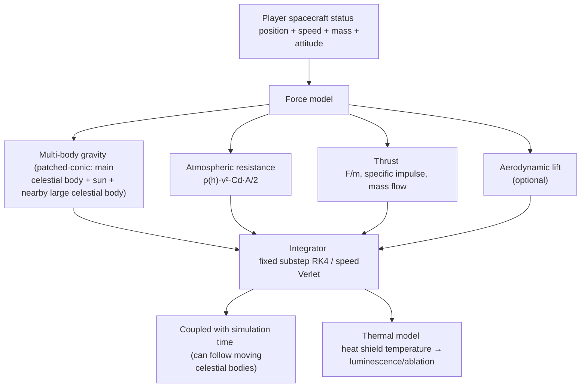

**Graded implementation** (to avoid destroying the existing feel with one rewrite):

| Level | Content | Default |
|---|---|---|
| L1 | Add gravity + fixed sub-step integration, retain the existing speed control | Do it first |
| L2 | Add atmospheric resistance + aerodynamic heating visualization (reentry luminescence) | Do it again |
| L3 | Mass/Thrust/Specific Impulse/Fuel/Δv Budget | Education Mode Switch |
| L4 | Collision with real terrain (use DEM height field to make ball-height field collision, low cost) | Must do |
| L5 | Retain "Arcade Feel" as a switchable mode (existing first-order lag model) | Enabled by default, simulation optional |

**Key Insight**: **L1 and L4 are the two best value for money**. With L1, the experience of "stopping in geostationary orbit and watching the earth's rotation" is established; with L4, it is safe to "fly close to the canyon". These two combined are less than the 1/3 workload of L3.

### 4.2 Camera Language (E8)

Minimal amount of code, huge immersion benefits:

- Walking: Footsteps drive head shaking (synchronized with audio)
- Landing: Shock Vibration + FOV Slight Compression
- Acceleration: FOV slight expansion + slight jitter
- High-speed re-entry: high-frequency jitter + screen edge vignetting
- Quiet: Breathing range

### 4.3 spatial audio (E9, E10)

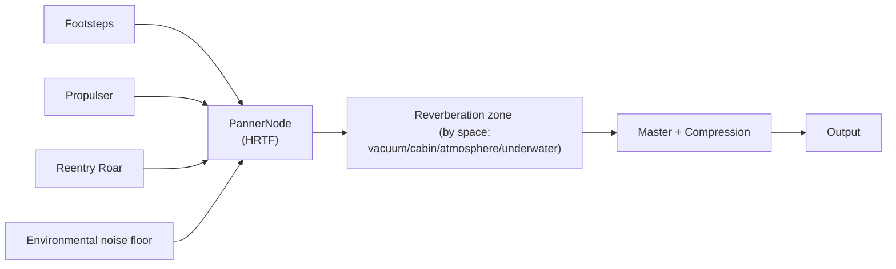

- Upgrade from 4 layer mono to true spatial audio (`PannerNode` + HRTF + Doppler)
- Added: thruster, RCS, reentry, UI, and environmental noise of each celestial body
- **Vacuum processing**: Physically there is no sound in a vacuum, but there is structural conduction sound inside a real spacecraft. The correct approach is to hear the sound "inside the cabin/space suit" and only the radio "outside the cabin". This is educational value as well as immersion.

### 4.4 VR Complete (E11)

| Gap | Solution |
|---|---|
| Cannot move in fly/walk mode | Access movement; parabolic arc for teleportation + landing preview + anti-vertigo in dark corner tunnels |
| The controller picks up empty piles | `_raycastBody` implements real raycast (the ray length is changed from 100 to km to configurable span) |
| post link is skipped | HDR + tone mapping is also used in VR (the more economical MSAA path can be used) |
| No touch | `XRInputSource.gamepad.hapticActuators` |
| No comfort options | Teleport/smooth movement switching, snap turn, vignetting, sitting mode |
| None UI | World Space Panel (not DOM) |
| No real machine verification | At least one each of Quest 3 / PICO / Vision Pro |

### Workload

3–5 months.

---

## Stage 5 · Closing

| Mission | Content |
|---|---|
| Three levels of image quality + bandwidth awareness (F4) | High / Medium / Low; `navigator.connection` + `deviceMemory` participate in binning; VR has an independent budget |
| Engine layer testing (F5) | Camera/ship/time/quality binning unit and regression testing |
| Rendering accuracy (F6) | Level floating origin (star system → planetary system → terrain level three); remote entity changed to double precision relative quantity |
| Accessibility (E18) | Restore zoom, `:focus-visible`, tag/results enabled Tab, `aria-live` broadcast navigation and narration, color blind mode, global `prefers-reduced-motion`, shake disabled |
| Content and multi-language (E17, E20) | Structured courses (replacing random knowledge cards), novice guide, teacher tools and bookmarks UI connection, name and description completion in non-Chinese and English languages ​​(currently es/ja/fr/de/ru is a mixture of "English name + Chinese description") |
| UI availability (E13–E16, E21, E22) | Movie/pure mode; narration subtitle layer; tag brightness grading and "name only" mode; 5400 small celestial bodies and landmark access search/tag/go; HUD dirty checking, tag pooling + caching DOM Quote |
| Offline and installation (E19) | Service Worker + layered pre-caching (first screen / on demand / offline package), fulfilling the teacher tool's "U disk offline" promise |
| Movie mode | Hide all UI with one click (**It is recommended to do it immediately, half a day**) |

### Workload

2–3 months.

---

# Chapter 6 Data and Asset Pipeline

## 6.1 Data source summary table

| Category | Source | License | Notes |
|---|---|---|---|
| Planet/satellite/small body ephemeris | JPL Horizons / SBDB | Public domain | Existing pipeline |
| Lunar terrain | LRO LOLA (118 m/px), LROC NAC DTM | Public domain | USGS Astrogeology |
| Mars terrain | MOLA (463 m), HiRISE DTM (1 m, 1,200+), CTX DTM | Public domain | PDS |
| Earth Terrain | SRTM (30 m), ASTER GDEM, GEBCO Seabed (450 m) | Public Domain | |
| Planetary image mosaic | USGS Astrogeology official mosaic | Public domain | **Replaces the current Solar System Scope secondary synthesis** |
| Albedo of airless objects | LROC WAC, MDIS, Cassini ISS | Public domain | |
| Star table | Gaia DR3 (G ≲ 12 about 10⁶ magnitude) + HYG/AT-HYG merged table | CC-BY-SA / Public domain | Contains proper motion, parallax, BP-RP color index |
| Galaxy background | ESO / Gaia full sky composite image | CC-BY | Replace current 530 KB JPEG |
| Small celestial body shape model | PDS SBN DSK / Triangular plate model | Public domain | 67P, Bennu, Itokawa, Eros… |
| Cloud/Weather | NASA GIBS (MODIS/VIIRS phase), NSIDC sea ice | Public domain | |
| Ring optical depth | Cassini UVIS/VIMS Ring optical depth profile | Public domain | |
| Sun | SDO AIA synthesis, SILSO sunspot number | Public domain | |

## 6.2 Asset pipeline architecture

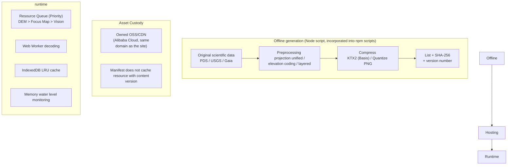

**Key Design**:

1. **Offline preprocessing of all assets**, only decoding and uploading are done during runtime (currently `fetch-dem.mjs` is already in this mode and needs to be expanded)
2. **Manifest versioning**, resources with content hash; the manifest is not cached (`RELEASE_READINESS.md:85` already exists)
3. **DEM has higher priority than the texture** (`demTiles.js:199` already has `priority 100+`)
4. **Video memory water level monitoring** (Currently there is only an upper limit on the number of pictures, but no upper limit on bytes - `demTiles.js:146` LRU is based on the number of pictures)

## 6.3 License and Signature Ledger

Currently, `THIRD_PARTY_NOTICES.md` only has one item, Astronomia; `README.md:194` has only one line of texture sources. **An asset-by-asset source ledger must be established**:

```jsonc
// reference/ATTRIBUTION.json
{
  "textures/earth_day.ktx2": {
    "source": "NASA Visible Earth / USGS",
    "derivedFrom": "MODIS 2014 composite",
    "license": "Public Domain",
    "url": "...", "retrieved": "2026-11-01"
  }
}
```

And generate a "data source" page in the footer. Most of the NASA/USGS/ESA data is in the public domain or CC-BY. **The cost of authorship is very low, but the legal risk is not low**.

---

# Chapter 7 Acceptance System (KPI Table)

## 7.1 domain KPI

| Domain | Metric | Current | After Phase 1 | After Phase 2 | Endgame | Measurement Method |
|---|---|---|---|---|---|---|
| Ephemeris | Planet vs JPL | ≤0.074° | ≤0.01° | — | ≤1×10⁻⁴° | `npm run verify` |
| Ephemeris | ΔT historical error | **89 s @1900** | ≤0.5 s | — | ≤0.5 s | Unit test vs IERS |
| Ephemeris | Satellite ±1 years vs JPL | 2–4° | ≤0.1° | ≤0.05° | ≤0.01° | New test |
| Shape | Lunar Terrain D_res (Global) | 9,200 km | 1,000 km | 1,000 km | 500 km | Script Calculation |
| Shape | Landing area terrain D_res | 9,200 km | **50 km** | 20 km | 10 km | Script calculation |
| Shape | Number of celestial bodies with real terrain | 3 | 12 | 20 | 25+ | List |
| Shape | Number of small celestial bodies in true shape models | 0 | 8 | 15 | 30+ | List |
| Light | BRDF | Lambert | Hapke (gasless) | All types | All types | Code review + blind test attribution |
| Light | Material Map Coverage | **0%** | 60% | 100% | 100% | List |
| Light | Atmosphere | Single Scattering | LUT+Ozone | +Clouds | +Aerosol Profile | Blind Attribution |
| Light | Post Chain | ACES only | +Flood | +Depth of Field/TAA | +Lens | Code Review |
| Light | Real number of stars in the sky | 132 | 10⁵ | 10⁶ | 10⁶ | List |
| Environment | Weather driven celestial bodies by date | 0 | 3 | 6 | 8 | List |
| Environment | Accurate eclipse coverage | 4 group triplet | Whole planet-satellite | Whole system | Whole system | Event comparison |
| Presence | Player Gravity | **None** | Yes | +Resistance | +Δv Budget | Code Review + Mission Demonstration |
| Presence | Real Collision | None | Terrain Height Field | Grid | Grid | Mission Demonstration |
| Presence | Spatial Audio | Mono | HRTF | +Reverberation Zone | +Doppler | Code Review |
| On the spot | Tasks that VR can complete | Only zoom | Can be moved + picked up | Full process | Full process | Real machine test |
| Comprehensive | **Blind test AUC (60 scenario)** | Not tested | — | ≤0.70 | **≤0.60** | Blind test platform |

## 7.2 return threshold (CI mandatory)

1. `npm test` 136 All items passed (already)
2. Reality scene set: no indicator regression > 5%
3. Performance: High surface ≥ 55 FPS, Low gear ≥ 45 FPS, mobile ≥ 30 FPS
4. Timing is stable: 3 frame-by-pixel difference in continuous shooting with the same parameters < 0.5% (currently there is no such check at all, and LOD jump/map pop is the most easily detectable "fake")
5. No new uncaught exception/resource failure (existing)

---

# Chapter 8 Milestones and Sequencing

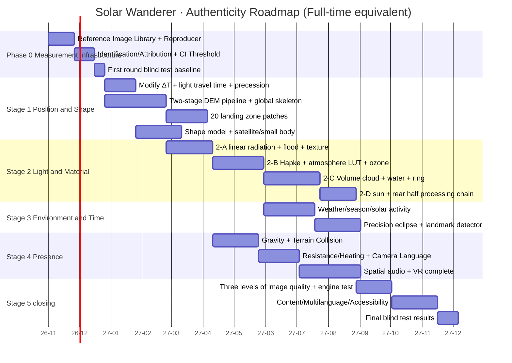

## 8.1 If only 3 months: the most cost-effective combination

Sorted by "reality improvement brought by unit workload", the top 5 names are:

**Let’s talk about five quick wins that can be completed in one or two days, but users will feel it immediately** (it is recommended to do it this week):

| Quick Win | Workload | Results |
|---|---|---|
| **E13 movie/pure mode** (one-click to hide all UI) | Half a day | Screenshots, screen recordings, demonstrations, VR available immediately |
| **E15 repairs narration and cropping** (adds `overflow` + line break + subtitle layer to `#hud-tip`) | Half a day | Navigation changed from "incomplete" to available |
| **A1 fixes ΔT piecewise polynomial** | 1–2 days | fixes serious errors in 1800 years +208 s |
| **A3 Moon Repair Entry** (Period +11.5%, intersection rate difference 160 times) | Half a day | Tidal lock attitude returned to correct |
| **E14 connects to the tour `action`** | 1 day | The narration of the three tours finally meets the screen |

**Make five more structural investments (about 3 months)**:

| Ranking | Tasks | Workload | Why |
|---|---|---|---|
| 1 | **Phase 0 Measuring Table** | 3–4 Weeks | Without it, the rest is all guesswork |
| 2 | **C2 material mapping pipeline (derived normal/roughness from DEM)** | 2 Week | From "0 sheets" to "all", the surface texture immediately changed qualitatively |
| 3 | **B1 DEM pushed to L6 + 3 landing zone patches** | 5 Week | The direct solution to "the secret is revealed as soon as it reaches the ground" |
| 4 | **C7 Physical Flooding + C1 Airless Celestial Objects Hapke** | 3 Week | The Sun and the Moon are the two most recognizable celestial bodies |
| 5 | **A6 ephemeris window expanded to 10 year** | 3 week | Dismantle the time bomb of satellite error 6° after "2027-10-01" |

**A total of about 3.5 months**, which can significantly improve the "most easily recognized as fake" scenarios and eliminate a severe degradation that will automatically trigger in 2027 years and 10 months.

---

# Chapter 9 Risks, Trade-offs and "Don't Do List"

## 9.1 Risk

| Risk | Impact | Countermeasures |
|---|---|---|
| Asset size explosion | Unacceptable deployment and first screen | Two-level pyramid + KTX2 + on-demand streaming; offline precomputation; video memory byte water level monitoring |
| Performance regression | New effects cannot run | Each batch must pass the performance threshold; mid-range equipment is given priority |
| Unified changes to the brightness system lead to changes in the sense of the entire scene | The existing visual regression is completely useless | A baseline must be established at stage 0; separate scene review |
| Data License | Legal Risk | Asset-by-Asset Ledger + Footer Source Page |
| Single person maintenance | Progress delay | Strictly released in batches; each batch has demonstrable results |
| "Indistinguishable" can never be declared | Loss of sense of purpose | Adopt executable goals (scenario set + blind test threshold) from section 4.4, declareable, incremental |

## 9.2 Definitely not to do it (save a lot of time)

| NOT TO DO | WHY | ALTERNATIVES |
|---|---|---|
| N volume fraction real orbit | Browser computing power is not enough, and "visual indistinguishability" is not required | High-level ephemeris + regular refresh of real data |
| MHD Heliosphere | Same as above | Shape of IBEX/ Voyager data fit |
| Complete ELP full series | Diminishing returns | Truncated to apparent position error < 1″ |
| Real-time path tracing global illumination | Insufficient computing power | Precomputed LUT + analytical mutual illumination approximation |
| Real fluid cloud simulation | Insufficient computing power | Volume raymarch + precomputed lighting + time domain reuse |
| 10⁹ Ring particles | Not enough computing power | Optical depth map + sparse particles |
| All 130 10,000 asteroids | Meaningless | Filter by apparent magnitude/diameter + statistical completion (clearly marked) |

## 9.3 About "Honest Labeling"

This is a core proposition of this plan: **A project that claims to be "incapable of distinguishing reality from simulation" must first be able to honestly point out where it is fake. **

It is recommended to add the "evidence level" layer (switchable) to UI:

- 🟢 Measured image coverage (LROC/HiRISE/Cassini, etc.)
- 🟡 Low-resolution actual measurement (MOLA global, Magellan)
- 🔴 Inference/programming (Venus details, Titan surface, Oort cloud)

This not only satisfies the integrity of scientific research, but is also excellent popular science content - it will tell users "where humans know a lot and where they know almost nothing."

---

# Chapter 10 Conclusion

## 10.1 Overall judgment

| Question | Answer |
|---|---|
| How real is the project now? | The ephemeris layer has reached engineering credibility; the rendering layer is "high-fidelity science level"; the interaction layer is "camera roaming" rather than "simulation" |
| How far is it from "indistinguishable"? | The image level gap is about 2 orders of magnitude (mainly reflected in BRDF, materials, atmosphere, post-production); the physical level is about 1 orders of magnitude; the physical and mental levels are almost blank |
| What should you do first? | **Stage 0 Measuring Station**. Followed by three "small but fatal" fixes: ΔT table, DEM level pinching, and material map zero |
| Can it be done? | Image level "Passed blind test on declared scene set" - **can be done**, takes about 12–18 months full-time. The physical level is "indistinguishable everywhere" - **can't be done**, and no browser project can do it |
| How long does it take? | Full 17–24 months full-time equivalent; current pace 3–4 years |

## 10.2 Three most important suggestions

**First, make the ruler first. **
The project already has 130+ probe scripts, 282 group control screenshots, and 136 tests - the engineering discipline is very good. But all of these are answering "Is it broken?", none of them are answering "Does it look like it?" The 3–4 weekly investment in stage 0 will determine whether every step in the following 20 months is in the right direction. This is the most important piece of advice in this article.

**Second, fix five "small but deadly" places first. ** They only take half a day to two days each, but each one drags down the overall realism:

| Location | Problem | After Repair |
|---|---|---|
| `time.js:45-47` | ΔT historical polynomial is used incorrectly (1800 year is offset by **208 s**, and the earth's rotation is incorrect by 0.87°) | The core selling point of "time machine" is established |
| moon entry for `moonsData.generated.js` | Period 30.47 days vs true value 27.32 days; node regression rate difference **160 times** | Tidal lock orientation return correct |
| `demTiles.js:46,55,64` | `maxLevel: 4` silently pinches off the L8 requested by `terrain.js:876` | There is room for the moon to take off from 2.67 km/px |
| Full warehouse | **0 normal/roughness map** | The ground surface has changed from a "ball with photos attached" to a "textured ground" |
| `public/data/ephemeris/manifest.json` | The sampling window only reaches **2027-10-01**, and then the satellite error is 2–6° | Destroy a time bomb |

The first four items totaled less than a week, and the fifth item took about three weeks. **None of them require new algorithm research, all are bug fixes and data additions. **

**Third, change the goal from "perfect" to "announceable." **
"Inability to distinguish reality from simulation" as an absolute goal can never be proven to be achieved - this will always leave the project in a state of "not enough" and put all external statements at risk of over-promise. Change it to **"On the declared scene set S, human blind test AUC ≤ 0.60"**, it becomes a goal that can be gradually advanced, announced to the outside world, and reviewed by a third party. And it’s more honest and more convincing.

## 10.3 Finally

This project has completed the most difficult part - **real scale, real ephemeris, real data, real seamless landing**. These are "have or not" questions, and most of the rest are "enough" questions.

"Is it enough" is an engineering problem, and engineering problems can be solved through measurement and iteration.

---

# Appendix A · Full gap comparison table

> See Chapter 3 for a complete list. A numbered index is given here for easy tracking.

| number | sentence | level | stage |
|---|---|---|---|
| A1 | ΔT table frozen + 1972 pre-polynomial error (1900 year + 89 s, 1800 year + 208 s) | P0 | 1 |
| A2 | Satellite analysis will degrade to 1.2–6.0° within one year (document writing ≤0.22°) | P0 | 1 |
| A3 | `moonsData` The moon entry itself is wrong (period +11.5%, intersection rate difference 160 times), affecting the tidal locking attitude | P0 | 1 |
| A4 | No nutation (±17.2″, 7 times larger than the planetary error) | P1 | 1 |
| A5 | No observer light aberration/light deflection/Shapiro | P1 | 1 |
| A6 | JPL The sampling window is only 16 months, and the model is changed silently outside the window | P0 | 1 |
| A7 | Earth/Mars/Mercury/Venus/Pluto and all satellites ignore oblateness | P1 | 1 |
| A8 | There are only 21/890 satellites (Saturn 6/60+, Uranus 5/27, Neptune 1/16, Pluto 0/4) | P1 | 1 |
| A9 | All tidally locked celestial bodies have no balance movement | P1 | 1 |
| A10 | Small celestial bodies 5412 share a single epoch and are pure two bodies; Ceres/Vesta is not a "world" | P1 | 1 |
| A11 | The asteroid belt/Kuiper belt/Oort cloud are static point clouds and never move | P1 | 1 |
| A12 | Only 4 comets; the Halley root number is 1976 years and is nothing but a gravitational term | P2 | 1 |
| A13 | 28 The intersection/perihelion velocities of TNO are all 0 | P2 | 1 |
| A14 | None N Bodies/Relativity/Tides/J2 Dynamics | P2 | 1 |
| A15 | Pluto retreats Standish, the accuracy is 12 times worse | P2 | 1 |
| A16 | Unimplemented JPL Table 2b, "±3000 year" lacks support | P2 | 1 |
| A17 | Dead code and outdated comments (`moonGeocentricFast`, etc.) mislead maintainers | P2 | 1 |
| B1 | **DEM sandwiched in L4 (requesting L8)** | P0 | 1 |
| B2 | ~28 objects have no terrain | P0 | 1 |
| B3 | Sub DEM Details fixed 1.6 m | P1 | 1 |
| B4 | Impact craters are noise contours | P1 | 1 |
| B5 | The rock is a deformed icosahedron | P2 | 1 |
| B6 | Small celestial bodies are all balls | P1 | 1 |
| B7 | Zero ring thickness; Jupiter/Neptune has no rings | P0 | 2 |
| C1 | **Pure Lambert** | P0 | 2 |
| C2 | **Zero Material Map** | P0 | 2 |
| C3 | No multiple scattering/ozone | P0 | 2 |
| C4 | The cloud is a textured spherical shell | P0 | 2 |
| C5 | No reflection/refraction on water surface | P0 | 2 |
| C6 | The sun has no corona (normal)/prominences/halo | P0 | 2 |
| C7 | **No post-processing** | P0 | 2 |
| C8 | Exposure without metering | P1 | 2 |
| C9 | Big details are noise | P1 | 2 |
| C10 | No planetary illumination | P1 | 2 |
| C11 | Display hack (I^0.55 / interiorBoost) | P1 | 2 |
| C12 | Starry sky 132 real stars + random points | P0 | 2 |
| C13 | No zodiacal light/airglow | P2 | 3 |
| C14 | Comet tail simplified; only 4 comets | P2 | 3 |
| D1 | No data driven weather | P0 | 3 |
| D2 | Edible Cone Overlay | P1 | 3 |
| D3 | Food search only 4 triplet | P1 | 3 |
| D4 | No solar activity cycle | P1 | 3 |
| D5 | No season vision | P1 | 3 |
| D6 | No night airglow/light phase | P2 | 3 |
| D7 | High-speed time domain aliasing (10 year/second = 61 day/frame) | P1 | 5 |
| E1 | **Player has no gravity** | P0 | 4 |
| E2 | No resistance/reentry | P0 | 4 |
| E3 | Massless/thrust/Δv | P0 | 4 |
| E4 | **Only one ball collides with the nearest celestial body** | P0 | 4 |
| E5 | Walking without slope restrictions; DEM updates to teleport players | P1 | 4 |
| E6 | Underwater buoyancy is constant | P1 | 4 |
| E7 | Decoupling player physics and simulation time | P1 | 4 |
| E8 | **NO CAMERA LANGUAGE** | P0 | 4 |
| E9 | **Audio full mono** | P0 | 4 |
| E10 | No engine/UI sound effects; volume unreachable | P1 | 4 |
| E11 | VR No movement/no touch/no post | P0 | 4 |
| E12 | No real device verification | P1 | 5 |
| E13 | **No movie/pure mode** (can be done in half a day) | P0 | 5 |
| E14 | Navigation `action` field never executed, narration does not match the screen | P0 | 5 |
| E15 | The navigation narration was cropped by CSS `nowrap` | P0 | 5 |
| E16 | All labels have distance numbers, no brightness grading | P1 | 5 |
| E17 | No novice guide | P1 | 5 |
| E18 | Basic lack of accessibility | P1 | 5 |
| E19 | There is a list of PWA but no Service Worker | P1 | 5 |
| E20 | Teacher Tools/Bookmarks/TTS Parameter None UI Entry | P2 | 5 |
| E21 | 5412 Real small celestial bodies and landmarks cannot be searched/displayed/cannot be accessed | P1 | 5 |
| E22 | Each frame 3× `innerHTML` + 199 label allocation | P1 | 5 |
| F1 | **No measure of realism** | P0 | 0 |
| F2 | The texture is a secondary synthesis | P1 | 1 |
| F2b | 31 Only 18 of the celestial bodies have stickers | P0 | 1 |
| F2c | 28 TNO + 4 Comet without texture | P1 | 1 |
| F2d | `newhorizons.bin` and `SPACECRAFT_TIMELINES` are dead resources | P2 | 1 |
| F3 | Ledger without observation source | P1 | 0 |
| F4 | Only two levels of image quality; no bandwidth awareness | P1 | 5 |
| F5 | Engine layer zero test | P1 | 5 |
| F6 | Remote entity fp32 position accuracy | P1 | 5 |
| F7 | Products 224 MB | P2 | 5 |

## A.1 Gap count at each stage

| Stage | P0 | P1 | P2 | Total |
|---|---:|---:|---:|---:|
| 0 Metrics | 1 | 1 | 0 | 2 |
| 1 position and shape | 4 | 9 | 5 | 18 |
| 2 Light and Material | 8 | 4 | 0 | 12 |
| 3 Environment and Time | 1 | 3 | 3 | 7 |
| 4 on the spot | 5 | 3 | 0 | 8 |
| 5 closing | 3 | 8 | 1 | 12 |
| **Total** | **22** | **28** | **9** | **59** |

---

# Appendix B · Terminology

| Terminology | Meaning |
|---|---|
| **D_res** | Resolvable distance. Surface sampling spacing ÷ human eye corner resolution. Closer than that, the secret begins to show |
| **Truth Frontier** | The boundary formed by D_res of all celestial bodies. The area within this line is "distinguishably false" |
| **Blind test AUC** | Subject's ability to distinguish "real/synthetic". 0.5 = Completely indistinguishable, 1.0 = See through at a glance |
| **BRDF / Hapke** | Bidirectional reflection distribution function / its physical model on the regolith of an airless body (including opposition brightening) |
| **LUT** | Lookup table. Precompute expensive physical integrals into textures offline and sample three times at runtime |
| **Two Level DEM Pyramid** | Global low-res skeleton + local high-res patch. Alternative to non-scalable global uniform quadtree |
| **Timeliness (timing artifacts)** | LOD jumps, texture pop, light flickering, etc. are "exposed only when they move" fakes |
| **Evidence Level** | Mark a certain area as a layer that is measured/low-resolution measured/inferred |

---

# Appendix C · Reproduction method of key figures

The key figures in this article can all be reproduced in the warehouse:

```bash
# 1) Current status of unit testing
npm test                                   # 136/136

# 2) ΔT historical error (Chapter 3 A1)
node -e "import('./src/astro/time.js').then(m=>{const d=m.dateToJD(new Date('1900-01-01T00:00:00Z'));console.log(m.deltaT(d))})"
# → 86.59 (true value −2.79, error 89.4 s)

# 3) DEM level is pinched off (Chapter 3 B1)
grep -n "maxLevel" src/scene/demTiles.js # → 46/55/64 are all 4
sed -n '875,884p' src/scene/terrain.js # → Request to L8

# 4) Zero Material Map (Chapter 3 C2)
grep -rn "normalMap\|roughnessMap\|envMap\|MeshPhysicalMaterial" src/ # → No output

# 5) Pure Lambert (Chapter 3 C1)
sed -n '303p' src/scene/planetMaterial.js

#6) Asset List
ls -la public/textures/ ; find public/dem -type f | wc -l
```

---

*This document is an analysis product and no code changes have been made to the warehouse. *
